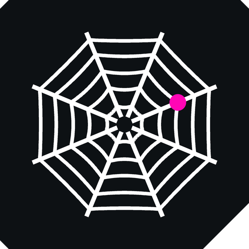

<p align="center"></p>

# JungleMesh

**Share your work at full quality.** JungleMesh is a free, open-source chat app that sends your samples, photos and project files straight to your friends, device to device: no server in between, no compression, no size limit, no account.

- **Made for creatives**: files arrive byte for byte as you sent them (WAV, FLAC, RAW, PSD, stems), of any size. Samples play right in the chat, images show at full resolution, and SoundCloud, Mixcloud, Spotify and YouTube links only load when you click.
- **Your crew**: invite-only rooms with text and voice channels, voice and video calls, screen sharing with sound (Windows), Markdown, reactions and edits.
- **Private by design**: no phone number or email, no telemetry, no server of ours. Messages and files travel directly between devices (Hyperswarm for chat and files, WebRTC for calls), encrypted in transit.

**Website and downloads: https://elendil-5mart1.github.io/JungleMesh/**

> Early beta, for **Windows**, **Linux** and **Android** (macOS builds are experimental). Not audited by third parties: treat it accordingly.

## Install

All files are on the [Releases](../../releases) page; the website picks the right one for your system.

**Windows 10/11**

1. Download `JungleMesh-Setup-x.y.z.exe` and run it (short setup wizard, no administrator rights needed).
2. The installer is **not signed yet**: Windows shows "Windows protected your PC". Click **More info**, then **Run anyway**. If you want to check the download, GitHub shows each file's SHA-256 next to it on the release page.

**Linux**

Download the `.deb` (Ubuntu, Zorin, Debian: `sudo apt install ./JungleMesh-x.y.z.deb`) or the `.AppImage` (other distributions, needs FUSE 2). Details in the [Linux install guide](docs/linux-install.md).

**Android** (64-bit phones)

Download `JungleMesh-x.y.z-android-arm64.apk` on your phone and open it; allow your browser to install apps when Android asks. Chat, rooms, files and voice calls (no video or screen sharing on the phone yet). New versions are offered in the app.

**macOS** (experimental)

`.dmg` builds for Apple silicon and Intel are attached to the releases, but they have not been tried on a real Mac yet and are not notarized by Apple: macOS blocks them until you allow them in System Settings › Privacy & Security.

## Getting started

1. Pick a display name (and a picture if you like) at the top of the home window.
2. In Settings › My profile, click **Copy my invite link** and send it to a friend (`junglemesh://add/…`).
3. Your friend opens the link (or pastes it in "add a friend") and confirms.
4. Chat, create a room, join a voice channel.

No account, no server, no phone number or email: your identity is a key pair stored on your device (`%APPDATA%\JungleMesh` on Windows, `~/.config/junglemesh` on Linux). An identity lives on one device at a time; the encrypted backup moves it to another one. Both people must be online at the same time to connect; pending messages are delivered on reconnection.

## Privacy and security

JungleMesh has no telemetry and never talks to a server of ours. Connections and voice are end-to-end encrypted. **But peer-to-peer means your friends can see your IP address.** What the app does to limit exposure (Settings › Privacy):

- **Stealth mode**: only friends and room members can connect to you; someone who merely has your invite code cannot see you online.
- **Hide my IP in voice calls**: calls (voice, video and screen sharing) go through a TURN relay you configure instead of directly to your friends.
- Hide message text in notifications, hide windows from screen capture, create a new identity, erase all data.
- **Encrypted backup** of your identity (passphrase-protected file), so losing your computer does not mean losing your friends and rooms.
- **Update checks** can be turned off: they are the only time the app contacts something other than your peers (GitHub).

For text chat, only a VPN can hide your IP. Data is **not encrypted on disk** by the app: enable your system's disk encryption (BitLocker, FileVault, LUKS) if your computer could be lost or stolen.

Read the full threat model, including what is **not** protected, in [SECURITY.md](SECURITY.md). To report a vulnerability, please follow the instructions there instead of opening a public issue.

## Known limits

- Without a TURN relay, voice may fail on very restrictive networks ("failed" in the voice panel).
- Voice channels are limited to 8 people (full mesh: each video or screen stream is sent separately to every viewer).
- Removing someone from a room is not cryptographic (see SECURITY.md).
- Updates are offered from GitHub releases (you confirm each step); the installer is not code-signed yet.
- Linux: update offers, Wayland, desktop notifications and voice are less tested than on Windows.
- Screen sharing at 1080p, and especially 60 fps, can lag: 720p is the reliable choice for now.
- Android: no video, no screen sharing, and no incoming call while the app is in the background yet.

## Develop

```bash
npm install
npm run dev          # run the app (default profile)
npm run dev:bob      # second profile, to test with two instances on one machine
npm run typecheck
npm run dist         # build the Windows installer into dist/
npm run dist:linux   # build the AppImage and deb (run it on Linux or in WSL)
```

Stack: Electron, React, Zustand, TypeScript, SCSS, Hyperswarm / Hypercore, WebRTC. See [CONTRIBUTING.md](CONTRIBUTING.md) to help. The interface is in English; translations are welcome.

## License

[MIT](LICENSE)
