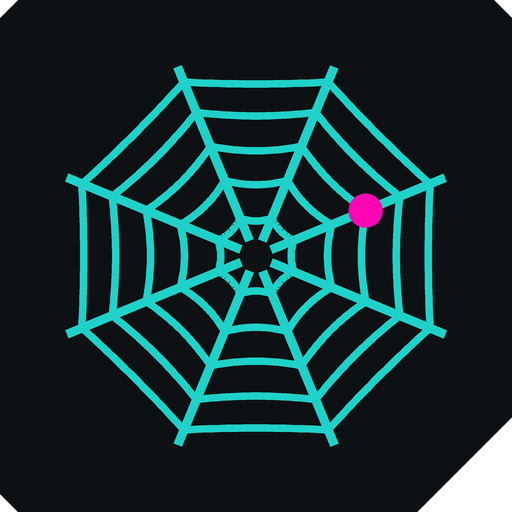

<p align="center"></p>

# JungleMesh

A **peer-to-peer desktop chat** in the spirit of Discord, with **no central server**: private messages, rooms with text and voice channels, one window per conversation. Everything goes directly between computers (Hyperswarm for connections, WebRTC for voice).

> Early development, **Windows only** for now. Not audited by third parties: treat it accordingly.

## Install

1. Download `JungleMesh-Setup-x.y.z.exe` from the [Releases](../../releases) page and run it (one-click install, no administrator rights needed).
2. The installer is **not signed yet**: Windows shows "Windows protected your PC". Click **More info**, then **Run anyway**. Compare the file's SHA-256 with the one published in the release notes before running it.

## Getting started

1. Pick a display name (and a picture if you like) at the top of the home window.
2. Click **copy my invite link** and send it to a friend (`junglemesh://add/…`).
3. Your friend opens the link (or pastes it in "add a friend") and confirms.
4. Chat, create a room, join a voice channel.

No account, no server, no phone number or email: your identity is a key pair stored on your computer (`%APPDATA%\JungleMesh`). Both people must be online at the same time to connect; pending messages are delivered on reconnection.

## Privacy and security

JungleMesh has no telemetry and never talks to a server of ours. Connections and voice are end-to-end encrypted. **But peer-to-peer means your friends can see your IP address.** What the app does to limit exposure (Settings › Privacy):

- **Stealth mode**: only friends and room members can connect to you; someone who merely has your invite code cannot see you online.
- **Hide my IP in voice calls**: audio goes through a TURN relay you configure instead of directly to your friends.
- Hide message text in notifications, hide windows from screen capture, create a new identity, erase all data.

For text chat, only a VPN can hide your IP. Data is **not encrypted on disk** by the app: enable your system's disk encryption (BitLocker, FileVault, LUKS) if your computer could be lost or stolen.

Read the full threat model, including what is **not** protected, in [SECURITY.md](SECURITY.md). To report a vulnerability, please follow the instructions there instead of opening a public issue.

## Known limits

- Without a TURN relay, voice may fail on very restrictive networks ("failed" in the voice panel).
- Voice channels are limited to 8 people (full mesh).
- Removing someone from a room is not cryptographic (see SECURITY.md).
- No automatic updates yet: install the new version over the old one.

## Develop

```bash
npm install
npm run dev          # run the app (default profile)
npm run dev:bob      # second profile, to test with two instances on one machine
npm run typecheck
npm run dist         # build the installer into dist/
```

Stack: Electron, React, Zustand, TypeScript, SCSS, Hyperswarm / Hypercore, WebRTC. See [CONTRIBUTING.md](CONTRIBUTING.md) to help. The interface is in English; translations are welcome.

## License

[MIT](LICENSE)
